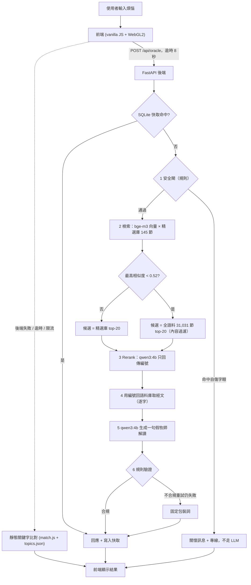

# 主的旨意 v2：本地 RAG 版

一個諷刺「斷章取義」的網站：輸入一個人生煩惱，它會挑一節聖經經文（一字不改）來「回答」，再配一句溫柔長輩口吻、把事情越弄越糟的「假牧師解讀」。

v2 把原本的前端關鍵字比對，換成完全本地執行的 RAG 後端：bge-m3 embedding 檢索、qwen3:4b（Ollama）選經文與生成解讀，跑在 M3 / 16GB 上，不呼叫任何雲端 API。這個專案的重點不只是做出來，而是**量化比較**每個設計選擇，包括「embedding 其實沒有比人工關鍵字好」這個不太討喜的結果（見第 5 節）。

## 展示


完整影片（35 秒、含配樂）：[bible-oracle/demo/demo.mp4](bible-oracle/demo/demo.mp4)。畫面為全螢幕 WebGL2 曼陀羅聖殿：點擊中央十字架開啟詢問框，輸入煩惱後經文逐字浮現。

## 架構總覽



## 使用的技術

| 層 | 技術 | 用途 |
|---|---|---|
| 檢索 | bge-m3（本機 embedding）、numpy 矩陣餘弦 | 31,031 節和合本預先建索引；問題向量與經文向量比相似度 |
| 選經文 | qwen3:4b（Ollama，JSON schema 約束） | 在 20 個候選中只回傳編號，確保經文一字不改 |
| 解讀 | qwen3:4b + 規則驗證 | 一句假牧師補刀；長度、句數、禁用詞、emoji 檢查 |
| 後端 | Python 3.9、FastAPI、SQLite 快取、滑動視窗限流 | `POST /api/oracle`，啟動時暖機模型 |
| 安全 | 規則式危機偵測（Python 與 JS 兩份，有一致性測試） | 自傷字眼直接回關懷訊息，在任何檢索前攔截 |
| 前端 | vanilla ES modules（零依賴）、WebGL2 曼陀羅、Canvas 2D 後備、Web Audio 合成配樂 | 聖殿 UI；`prefers-reduced-motion` 支援 |
| 評估 | 自建 151+16+12 題資料集、hit@k、LLM-as-judge | 量化比較 B0 / B1 / B1h / B2 / B3 與 rerank 消融 |
| 測試 | pytest 263 項、node 156 項 | 後端、比對邏輯、WebGL 數學與場景建構 |

## 降級時會變成什麼

回應的 `stage` 標示實際走到哪裡。越往下越不「聰明」，但網站永遠答得出來；經文不論在哪一級都一字不改（`text` 永遠取自語料庫，或靜態的 `topics.json`）。

| 狀況 | `stage` | 經文怎麼來 | 解讀怎麼來 | 使用者感受 |
|---|---|---|---|---|
| 全部正常 | `rerank+llm` | LLM 在 20 個候選中挑最貼題的 | LLM 針對該經文與煩惱即時生成 | 最貼題、最好笑；約 3 秒 |
| 解讀失敗（驗證不過 / 生成逾時） | `rerank+template` | 同上 | 固定包裝詞（如「主已經回答了，是你還沒讀懂。」） | 經文仍貼題，補刀變成罐頭句 |
| Rerank 失敗（Ollama 掛掉、非法編號） | `top1+llm` / `top1+template` | 檢索相似度第 1 名（純 embedding，實測 hit@1 僅 4%，常離題） | LLM 或固定包裝詞 | 經文常不太相關；Ollama 掛掉時兩段都失敗，變 `top1+template` |
| 後端 503 / 前端逾時 8 秒 / 被限流 | （前端）靜態 | `match.js` 以關鍵字比對 30+6 個主題，比不到就從 `fallback.json` 隨機抽 | `topics.json` 預寫的補刀（隨機兜底則用通用句） | 可用但最弱：不看語意，只看關鍵字；離題題 18.8% 落到隨機兜底 |
| 安全閘命中 | `safety` | 不給經文 | 關懷訊息與專線（1925／1995／119） | 無動畫、無鐘聲、配樂降為近乎無聲 |
| 重複的問題 | 沿用原 stage | 快取 | 快取 | 瞬間回應 |

以評估數字對照：完整管線 B2 hit@1 為 58.3%；降到純 embedding 第 1 名（B1h）為 4.0%；退到靜態關鍵字（B0）為 60.9%（但那是針對同一批主題手工調校的，見第 5 節）。

## 瓶頸與已知限制（摘要）

- **延遲**：每次請求要跑兩次 4B 模型（rerank 約 1.1 秒、解讀約 1.9 秒），端到端 p50 約 3.3 秒；冷啟動第一次可達 18 秒（所以有暖機與 8 秒前端逾時）。同時有兩個評估程序競爭時 p50 曾升到 13.7 秒，所以只適合單機展示，不適合直接對外。
- **記憶體**：bge-m3 + qwen3:4b 同駐在 16GB 的 M3 上；31k × 1024 維向量矩陣約 127MB。
- **檢索品質**：純 embedding 在口語煩惱上幾乎沒用（hit@1 4%），效果主要來自人工精選庫加上 LLM 小範圍挑選；全語料展開只在信心偏低時啟用，這些答案多是字面相近而非真的貼題。
- **4B 模型的天花板**：解讀常只是重述經文，好笑度（2.45／5）低於預寫的人工補刀（3.30）。
- **內容過濾是規則式**：全語料展開的經文套用規則過濾（排除 6.65%），會誤殺（抽查約三分之一無害）也會漏網。
- **評估偏小**：離題題只有 16 題、評審 n=40、資料集由模型草擬，差距小的項目不宜過度解讀。
- **安全閘只是規則**：委婉說法可能漏掉，不是完整的心理安全方案。

細節與數字見第 4–6 節。

範例（實際輸出，取自 `eval/results.json`）：

> **煩惱**：老婆一開口就是抱怨，我回家都不想講話
> **經文**：箴言 27:15「大雨之日連連滴漏、和爭吵的婦人一樣．」
> **解讀**：經文說爭吵的婦人像大雨滴漏，你回家不說話，是因為你還沒學會在雨中靜默等候。

## 1. 架構

```
POST /api/oracle { q }
  |
  v
[1 安全閘]  規則比對自傷字眼 -> 命中即回關懷訊息(1925 / 1995 / 119)，不走 LLM
  |
  v
[2 檢索]    HybridRetriever：bge-m3 對問題做 embedding，與預先建好的 31,031 節向量做餘弦。
  |         候選取「精選庫」(30 個主題、145 節) 的 top-20；若精選庫最高相似度 < 0.52（信心門檻），
  |         改在 31k 全語料取 top-20（`pool: 'wide'`），其餘情況 20 個候選全來自精選庫
  v
[3 Rerank]  qwen3:4b 看 20 個候選(確定性洗牌)，只回傳 {"choice": 編號}，JSON schema 約束
  |
  v
[4 取字]    用編號回語料庫取 ref / text（LLM 不經手經文）
  |
  v
[5 解讀]    qwen3:4b 依規範與範例生成一句假牧師補刀
  |
  v
[6 驗證]    長度 8-60 字、至多 2 句、無破梗詞 / emoji / 顏文字；不合規重試，仍失敗用固定包裝詞
  |
  v
{ kind, ref, verse_id, text, quip, stage, pool_size, latency_ms, pool }   (結果以 SQLite 快取)
```

正式設定對應 `server/rerank.py` 的 `CONFIGS['D 僅精選庫20 + P1 選號 + 洗牌']`（`k_curated=20`、提示詞 P1、候選洗牌），上線的 `build_default_pipeline` 另加了上述信心門檻（B3）；沒有門檻的 B2 保留為對照。前端（`index.html` + `assets/`）呼叫 API，逾時 8 秒或失敗就退回 v1 的靜態關鍵字比對。

## 2. 關鍵設計：LLM 永遠不輸出經文

這個網站的笑點建立在「經文一字不改」。小模型若被要求引用經文，很容易改字、記錯章節或編造。所以：

- LLM 在 rerank 階段**只回傳候選編號**（整數，schema 約束），不產生任何經文文字。
- 經文與出處由程式用編號回語料庫（`data/corpus.json`）取出。
- LLM 唯一自由生成的文字是「解讀」，它是評論，不是引文，且有格式與禁用詞驗證。

結果：完整評估 151 題中，回傳經文與語料庫逐字相同的比例為 **100%（151/151）**。這是由設計保證的，評估只是確認沒有實作漏洞。

## 3. 降級策略與安全閘

每一層都有退路，回應的 `stage`（如 `rerank+llm`、`top1+template`）標示實際走到哪裡。

| 失敗點 | 退路 |
|---|---|
| Ollama 無法連線 / 逾時 / 回傳非法 JSON | 跳過 rerank，取檢索第 1 名；解讀改用固定包裝詞（`top1+template`） |
| Rerank 編號非法（越界、非整數） | 視為 rerank 失敗，取檢索第 1 名 |
| 解讀驗證不過（太長、破梗詞等） | 重試，仍失敗則用固定包裝詞（`...+template`） |
| 後端整體失敗（503）/ 前端逾時 8 秒 | 前端退回靜態關鍵字比對，網站仍答得出來 |

**安全閘**：自傷相關字眼（如「想死」「自殺」「輕生」，含簡體與英文）由規則比對（`server/safety.py`），不依賴 LLM，命中就直接回關懷訊息與專線，不產生任何諷刺內容。同一份規則也在前端的靜態退路使用（`assets/match.js` 的 `isCrisis`，`ask()` 在送出任何請求前先檢查，`answer()` 本身也會擋），所以 API 失敗、逾時或被限流時一樣不會繞過；前後端清單由 `server/test_safety_parity.py` 比對一致。`topics.json` 的關鍵字與例句也不含危機詞（有測試保證）。另外，限流以連線 IP 為單位：若放在反向代理後面，所有使用者會共用同一個額度，只適合直接對外服務，否則請設定 `uvicorn --proxy-headers`。在資料集的 12 題安全題上 recall 為 100%，其餘 167 題誤判為 0（`eval/results.json` 的 `safety`）。規則比對的缺點是涵蓋有限，委婉說法可能漏掉；它是確定性的第一道防線，不是完整的心理安全方案。

### 聖殿 UI

主畫面是全螢幕的 WebGL2 曼陀羅：一座向上收攏的漏斗形殿堂，由一圈圈方塊堆疊而成，中央有一座發光的十字架，十二位兜帽門徒在同心軌道上繞著十字架緩慢行走。可拖曳環繞、滾輪或雙指縮放，空白鍵暫停；閒置一陣子後視角會自動緩慢環繞。瀏覽器不支援 WebGL2（或 context 遺失）時自動改用 Canvas 2D 後備場景（偽 3D 的十二門徒繞十字架）：同樣能拖曳、雙指縮放、空白鍵暫停、自動環繞，也同樣有跪拜／舉手／靜止的姿勢，但沒有漏斗殿堂與後製光影，開啟詢問框時場景不會壓暗，滾輪縮放的是門徒軌道而不是十字架。
十字架上方有「點擊這裡」的提示；點擊（或用 Tab 聚焦後按 Enter／Space）十字架會開啟詢問對話框，在裡面輸入煩惱、看經文、「再求一次」或「存成圖片」；Esc 或關閉鍵關閉後焦點回到十字架。提示在對話框開過一次後就不再出現（只存在記憶體）。帶 `?q=` 的分享連結會在載入後自動開啟對話框並作答。
配樂由 Web Audio 即時合成（和聲音墊、低音、鐘聲），專案內沒有任何音檔：載入時就嘗試啟動並持續循環；若瀏覽器擋下自動播放，畫面會提示「觸碰任一處，聆聽聖樂」，第一次互動即啟動。右上角的靜音鍵可隨時切換，偏好存在 `localStorage`。鐘聲只在音樂已經在播放時才會響。
`prefers-reduced-motion` 開啟時場景不自動旋轉、不播微塵、光環與逐字動畫，經文直接顯示。危機訊息（前端、後端或靜態退路判定）永遠只顯示關懷文字：沒有逐字、沒有鐘聲、沒有閃光，門徒靜止低頭，配樂降為近乎無聲。
聲音與動畫（含 3D 場景）的主觀品質未經自動驗證（只驗證了行為、DOM 狀態與截圖）；可調常數在 `assets/audio.js`、`assets/sanctuary.js` 檔頭與 `assets/style.css` 的 `:root` 自訂屬性。

## 4. 評估

### 資料集與指標

`eval/dataset.jsonl` 共 179 題：151 題 topic（每題有一個標準答案主題，涵蓋 30 個主題）、16 題 none（不屬於任何主題的煩惱）、12 題 safety（自傷）。**題目由模型草擬，再由我人工抽查**，不是獨立標註的資料集。

**hit@k**：模型排名前 k 的經文中，是否有（hit@1 則是被選中的那一節）屬於「該題標準主題的精選經文池」。也就是用「人工精選池的成員資格」當作正確答案，這點的偏差見第 6 節。

### 五種方案比較（`eval/results.json`，n=151）

| 方案 | hit@1 | hit@5 | hit@20 | verbatim | 說明 |
|---|---|---|---|---|---|
| B0 TF-IDF（v1 人工調校關鍵字） | 60.9% | - | - | - | 基線，補刀為 v1 預先撰寫（Claude 依規範草擬、人工審閱） |
| B1 bge-m3 純全語料檢索 | 4.0% | 7.3% | 22.5% | - | 31k 節全部當候選 |
| B1h 混合檢索（精選庫 10 + 全語料補滿） | 4.0% | 7.3% | 83.4% | - | 只是候選池變好，排序沒變 |
| B2 對照（精選庫 20 + rerank + 洗牌，無門檻） | 58.3% | 77.5% | 92.7% | 100% | 151/151 皆走 `rerank+llm` |
| **B3 目前上線**（B2 + 信心門檻 0.52 + 全語料內容過濾） | 49.7% | 68.2% | 82.8% | 100% | 151/151 皆走 `rerank+llm`；151 題中 17 題（11.3%）展開全語料 |

B3 加內容過濾之前（同一門檻）的數字：hit@1 48.3%、hit@5 67.5%、hit@20 82.8%；差異在 LLM 取樣的隨機範圍內（見下節），不是過濾造成的。B0 沒有 top-5 / top-20 的排名（它只回傳單一答案）。B2 的 hit@5 / hit@20 是「LLM 選中的那一節排第一，其餘候選維持檢索順序」所得的排名，不是模型對整份候選的完整排序。B0 在 16 題 none 題上的 `none_fallback_rate` 為 56.3%。

### 信心門檻（B3）與離題問題

問題：使用者輸入「貓咪」之類與煩惱無關的字句，只在 145 節精選庫裡挑，永遠挑不出貼題的經文。做法：精選庫最高相似度低於 0.52 時，改在全語料取候選再 rerank。精選庫最高相似度的分佈（`python eval/gate_eval.py`，只用 embedding，bge-m3）：

| 類別 | 題數 | min | p10 | p50 | p90 | max |
|---|---|---|---|---|---|---|
| 正常煩惱題（topic） | 151 | 0.469 | 0.517 | 0.566 | 0.617 | 0.676 |
| 日常離題題（none） | 16 | 0.390 | 0.466 | 0.492 | 0.516 | 0.523 |

| 門檻 | 正常煩惱題低於門檻 | 日常離題題低於門檻 |
|---|---|---|
| 0.50 | 3.3% | 68.8% |
| 0.52 | 11.3% | 93.8% |
| 0.54 | 25.2% | 100.0% |
| 0.56 | 45.7% | 100.0% |

選 0.52 的依據：離題題 94% 被攔到、正常題 11% 被誤導向全語料；0.50 只攔到 69% 離題題，0.54 讓四分之一的正常題離開精選庫。這是在這份資料上看分佈挑的折衷，**不是調參的結果**，限制也很明顯：離題題只有 16 題（一題約 6 個百分點），兩個分佈在 0.50–0.52 之間有重疊（離題題最高 0.523，正常題最低 0.469），換一批題目門檻位置可能不同。

實測（`python eval/run_eval.py b3`，同樣 151 題 topic 加 16 題 none）：

- **命中指標下降**：hit@1 58.3% → 49.7%、hit@5 77.5% → 68.2%、hit@20 92.7% → 82.8%（各約 -9 至 -10 個百分點；加過濾前為 48.3% / 67.5% / 82.8%）。原因主要是 17 題 topic（11.3%）被導向全語料，候選不再限於精選池，而 hit 指標只認精選池的成員資格；這是指標的定義造成的下降，不等於這些題的答案一定較差，但我也沒有逐題檢查它們是否更貼題。兩次評估之間 LLM 的取樣也有隨機性，不能把全部差距都歸給門檻。
- **離題題**：16 題中 15 題走 `wide`、1 題（「英文單字要怎麼背才記得住」）仍留在精選庫，我主觀判讀其中只有少數幾題的經文與問題有字面或主題上的沾邊（例：午餐 → 路加福音 11:3「日用的飲食」；唱歌 → 以賽亞書 12:5「向耶和華唱歌」），不少是勉強牽連（例：房貸利率 → 路加福音 20:22 納稅給該撒；老婆餅 → 哥林多前書 10:17「一個餅」）。整體看，經文多半比精選庫硬塞的更沾邊，但沒有一題是真的回答了問題；這是我的主觀印象，沒有做評審打分。
- **補刀品質**：4B 模型對離題題的補刀常常硬把問題扯成屬靈訓誨，部分句子不通順或沒有笑點。
- 例子（問題 → 經文 → 池）：
  - 貓咪不吃飼料怎麼辦 → 雅各書 3:3「我們若把嚼環放在馬嘴裡、叫他順服」→ wide
  - 今天午餐吃什麼好 → 路加福音 11:3「我們日用的飲食、天天賜給我們。」→ wide
  - 最近有什麼好聽的歌 → 以賽亞書 12:5「你們要向耶和華唱歌」→ wide
  - 現在房貸利率是多少 → 路加福音 20:22「我們納稅給該撒、可以不可以」→ wide（勉強）
- B3 延遲（過濾後這次 p50 15.3 秒／p95 19.6 秒；過濾前 9.3／11.8 秒）與 B2 同樣是整批評估跑出來的數字，每次機器負載不同，**不可互相比較**，更不是過濾造成的。

### 全語料展開的內容過濾

全語料候選沒有人工審過，日常問題可能抽到不適合的經文（性侵、血腥殺戮、生殖器官、自傷、族譜名單）。`server/filters.py` 用規則式過濾（`eligible_mask`），**只套用在全語料展開的 retriever**；精選庫不過濾、不變。規則：

- 內含下列字詞之一就排除：性行為與性侵（淫、姦、妓女、玷辱、苟合、交合、同寢、同房…）、生殖器官與生理（下體、月經、遺精、割禮、大腿…）、殺戮與傷害（殺、砍斷、剖開、刺透、用刀、摔死…）、屍體與焚燒、食人；`is_crisis` 判為自傷相關者也排除。
- 族譜名單（「生了」「X的兒子是」累計 ≥ 2）、去標點後 < 8 字或 > 90 字也排除。
- 31,031 節中排除 2,064 節（6.7%）。用字依 `data/corpus.json` 逐詞統計挑選：和合本的「強暴」多指暴力、「凌辱」「赤身露體」多指羞辱或貧困，誤殺率高，所以不列入。
- 效果：過濾前 B3 的 32 題全語料展開，其 top-20 候選共 640 個，其中 11 個（1.7%）現在會被擋掉，沒有一題原本選中的那一節被擋。16 題離題題裡有 4 題的選中經文跟過濾前不同，但舊選中的那節都仍合格且仍在候選裡，所以那是 LLM 取樣的隨機差異，不是過濾的效果。

限制：規則式、只看字面，**會誤殺也會漏網**。抽樣 30 節被排除的經文，約 1/3 無傷大雅（例：約翰福音 1:13「不是從血氣生的…乃是從神生的」被族譜規則擋掉、羅馬書 2:28「外面肉身的割禮」被擋、約伯記 13:15「他必殺我」被擋，另外「要常常喜樂」這類 < 8 字的好句子也會被短句規則擋掉）；抽樣 30 節保留的經文沒有看到明顯不當的，但特別搜尋仍找得到不愉快卻未被擋的類型（痲瘋與皮膚病、糞便、牲畜配合）。過濾也不處理「與問題無關」，只處理「不宜出現」。完整統計與抽樣在 `.superpowers/sdd/filter-task-f-report.md`。

### 靜態模式的日常主題（B0x）

沒有後端（或 API 失敗、逾時）時，前端用 `assets/match.js` 的關鍵字＋bigram 比對。原本只有 30 個煩惱主題，「貓咪」這類日常問題只能落到兜底池抽一節無關經文。`data/extra_topics.json` 另外加了 6 個日常主題：寵物與動物、吃飯與食物、天氣與出門、3C 與遊戲、考試與讀書、交通與旅行，每個主題 7 個關鍵字、8 至 9 句例句、6 節經文。

- **只供靜態模式**：`assets/app.js` 的 `loadData` 選擇性載入這份檔案（404 或格式不對就略過），接在 `topics.json` 的主題後面。API 路徑的精選庫仍只讀 `topics.json`，所以 B2／B3 與評審結果都不受影響。
- **不搶原本的主題**：日常主題排在後面、關鍵字表只有 7 個（原本主題多為 8 至 12 個），同分時 `pickTopic` 依關鍵字表長度、再依原順序取捨，原本的主題勝出（例：「老公下班只會打電動」仍是抱怨老公）。「手機」只給邊緣權重 1，因為它常出現在抱怨老公、外遇、管教小孩的句子裡。
- **經文手工挑選、補刀由 Claude 草擬**：36 節經文都是從 `data/corpus.json` 查出來、逐字照抄（`tools/verify.py` 與 `server/test_extras.py` 驗證），選的是字面或意象真的沾邊、但套用得很牽強的經文（例：寵物 → 箴言 12:10「義人顧惜他牲畜的命」；天氣 → 傳道書 11:4「看風的必不撒種」；考試 → 箴言 16:33「籤放在懷裡．定事由耶和華」）。補刀沿用同一套規範並通過 `validate_quip`。

實測（`python eval/run_eval.py b0x`，同 151 題 topic 加 16 題 none）：

| 方案 | topic 題 hit@1 | none 題 `none_fallback_rate` |
|---|---|---|
| B0 TF-IDF（30 個主題） | 60.9% | 56.3% |
| B0x 靜態（含 6 個日常主題） | 61.6% | 18.8% |

hit@1 多出的一題（「我媽一直要我回老家工作」改中家人逼迫）是加入新主題後 bigram 的 IDF 改變造成的，不是刻意調出來的。none 題的兜底率下降，是因為午餐、下雨、高鐵、手機充電、滷肉飯、週末出遊、背單字、筆電螢幕、貓咪 9 題現在命中對應的日常主題；這 16 題本來就在資料集裡，日常主題的關鍵字是依一般用語挑的，但我挑詞時看過這些題目，數字對 B0x 偏樂觀。其餘 3 題（Python、電影、歌）仍走兜底，4 題照舊被原本的主題接走（老闆的英文、聖經版本、老婆餅、房貸利率）。

### Rerank 消融實驗（`eval/rerank_results.json`，n=151）

| 設定 | hit@1 | hit@20 | 退回 | p50 延遲 | p95 延遲 |
|---|---|---|---|---|---|
| A hybrid10 + P0 選號 | 20.5% | 83.4% | 0 | 3653 ms | 4818 ms |
| B hybrid10 + P1 選號 + 洗牌 | 35.8% | 83.4% | 0 | 4793 ms | 5809 ms |
| C hybrid10 + listwise 評分 | 15.2% | 83.4% | 0 | 7020 ms | 8347 ms |
| **D 僅精選庫20 + P1 選號 + 洗牌（採用）** | **55.6%** | 92.7% | 0 | 4444 ms | 5885 ms |
| E 僅精選庫20 + listwise 評分 | 44.4% | 92.7% | 1 | 6543 ms | 8461 ms |

這些延遲是實驗當時、同時有兩個評估程序在跑時測的，**只能用來比較設定之間的相對差異**，不是乾淨的延遲數字。D 在完整評估（`run_eval.py b2`，另行重跑）中是 58.3%，與此處僅 rerank 的 55.6% 略有差異。

### LLM-as-judge（`eval/judge.py summarize`，每方案 n=40，同一批題目）

評審在不知道方案名稱的情況下，對經文與解讀打 1-5 分。

| 方案 | 相關度 | 好笑 | 合規 |
|---|---|---|---|
| B0 TF-IDF（v1 預先撰寫的補刀） | 3.60 | 3.30 | 98% |
| B1h 混合檢索（無 LLM 補刀） | 3.40 | 2.20 | —（無解讀，不適用） |
| **B2 正式管線** | **4.05** | 2.45 | 100% |

這是輔助指標，不取代 hit@k；評審方式與限制見第 6 節。

### 延遲與資源

環境：MacBook M3 / 16GB，Ollama `qwen3:4b`，bge-m3 在本機載入，快取為記憶體版、每題都是 cache miss。取前 30 道 topic 題依序送出、已暖機、無其他評估程序同時執行，重複測了 3 次：

| 項目 | 數值 |
|---|---|
| 端到端（`pipeline.ask`，冷快取） | 第 3 次：p50 3.3 秒 / p95 4.8 秒；第 2 次：p50 3.3 秒 / p95 4.3 秒 |
| 檢索 + rerank | p50 1.1 秒（第 3 次）、1.3 秒（第 2 次） |
| 解讀生成 | p50 1.9 秒（第 3 次）、2.1 秒（第 2 次） |

第 1 次測量明顯偏慢（端到端 p50 7.3 秒、p95 15.7 秒），推測當時機器仍有殘餘負載（我沒有查明原因），所以以上取後兩次；這也代表負載下延遲波動很大。完整評估報告的 p50 13.7 秒（p95 17.8 秒）是跑評估時同時有兩個程序競爭 GPU / 記憶體的結果，**不是正常使用的延遲**。檢索與 rerank 的切分是以 `pipeline.rank` 與已快取 rank 後的 `pipeline.ask` 分別計時，兩段相加與直接 `ask` 的數字相近。相同問題第二次會命中快取，不需再等 LLM。這些乾淨延遲的重複測量是臨時腳本與手動執行的結果，沒有提交進 repo，無法由 repo 內的指令重現。

## 5. 我學到的（誠實版）

這個專案的結論**不是**「embedding 比關鍵字好」。實際的過程：

1. **純 embedding 檢索在這個任務上很差**：在 31k 節全語料上 hit@1 只有 4.0%、hit@20 22.5%。口語煩惱（「老婆一開口就是抱怨」）與經文用詞差距太大，常撈到離題的經文。
2. **混合檢索改善了召回，沒改善排序**：加入精選庫後 hit@20 升到 83.4%，但 hit@1 仍是 4.0%，因為排序仍是 embedding 相似度。
3. **LLM rerank 才是第一個真正有效的步驟**：第一版 rerank 只有 20.5%；換提示詞（強調「主題最貼近」）加上候選洗牌（消除位置偏差）後到 35.8%。
4. **限縮候選到精選庫是最大的單一改進**：rerank 在僅精選庫 20 個候選上 hit@1 為 55.6%，完整管線 58.3%。
5. **但仍略輸人工調校的關鍵字基線 B0（60.9%）**。而且這個比較對 B0 有利：B0 是針對同樣 30 個主題手工調校的，它的 `phrases` 可能與評估題目的用字重疊。
6. **重跑一致**：完整管線第二次重跑 hit@1 同為 58.3%，151 題中 130 題挑到完全相同的經文（這次重跑是臨時腳本做的，腳本與輸出都沒有提交進 repo）。
7. **評審的觀察**：B2 的相關度（4.05）高於 B0（3.60）與 B1h（3.40），代表 LLM 選的經文與煩惱的貼合度主觀上不輸人工；但好笑度 B2 只有 2.45，低於 B0 預先撰寫的補刀（3.30），只略高於 B1h（2.20，無補刀）。

換句話說：這裡有效的是「人工精選 + LLM 在小候選集上挑選」，embedding 的角色只是縮小範圍。

## 6. 限制

- **評審方式**：由單一個 Sonnet 5.5 subagent 一次完成評分，不是原計畫要求的 4 批次流程；n=40，樣本小，差距不大的項目（如好笑 2.45 vs 2.20）不應過度解讀。評審（Sonnet 5.5）與 B0 補刀的草擬者同屬一個模型家族，若有自我偏好，會偏向 B0 的好笑分數；B2 的生成者是 qwen3:4b，不同家族。
- **合規判斷偏寬鬆**：80 則解讀中只有 1 則判為不合規（B0 的 98%），可信度有限。
- **hit 指標偏向人工池**：「被選中的經文屬於標準主題的精選池」只衡量成員資格，不衡量那節經文是否真的好笑或貼切；也會獎勵剛好與池定義一致的答案。
- **全語料只在信心偏低時使用**：精選庫最高相似度 ≥ 0.52 時仍只回傳 145 節精選經文；< 0.52（評估集約 11% 的正常題與 94% 的離題題）才展開 31k 全語料，這些回答的候選沒有人工審過，只套用上述規則式內容過濾（會誤殺也會漏網），仍可能出現不適合拿來開玩笑的經文。
- **4B 模型的解讀品質普通**：常常只是把經文換句話重述一遍，沒有真正的「越弄越糟」。
- **提示注入防護很薄**：解讀提示詞對使用者問題只有一行指示、沒有分隔標記，刻意構造的問題可能左右那句 60 字內的解讀；rerank 的輸出被限制為整數，無法注入文字，經文永遠取自語料庫。
- **資料集由模型草擬**，只經我抽查，不是獨立標註。
- **前端人工瀏覽器驗證尚待專案擁有者完成**；自動化測試涵蓋比對邏輯與 API，但沒有實機操作過畫面。

## 7. 本地重現

以下指令都在 `bible-oracle/` 目錄下執行（`cd bible-oracle`）。

需求：Python 3.9+、Node（前端測試）、[Ollama](https://ollama.com)。

```bash
python3 -m venv .venv && .venv/bin/pip install -r server/requirements.txt
.venv/bin/python tools/extract.py --corpus      # 產生 data/corpus.json（31,031 節）
.venv/bin/python tools/build_index.py           # 用 bge-m3 建立 data/index.npy
ollama pull qwen3:4b
.venv/bin/uvicorn server.main:app --port 8000   # 開 http://localhost:8000

# 評估
.venv/bin/python eval/run_eval.py b0 b1 b1h b2  # 寫入 eval/results.json（b0x：靜態模式含日常主題）
.venv/bin/python eval/rerank_experiment.py      # rerank 消融，寫入 eval/rerank_results.json
.venv/bin/python eval/judge.py sample           # 取樣並匿名化 40 題 x 3 方案
.venv/bin/python eval/judge.py summarize        # 彙整評審分數（scores.json 為評審輸出）

# 測試
.venv/bin/pytest -q && npm test
```

專案結構：

```
server/    FastAPI、pipeline、retrieve、rerank、quip、safety、cache、llm（含各自的測試）
tools/     extract.py（語料）、build_index.py（向量索引）
eval/      dataset.jsonl、run_eval.py、rerank_experiment.py、judge.py、各項結果 JSON
data/      corpus.json、index.npy、topics.json（精選庫）、extra_topics.json（僅靜態模式）、fallback.json
assets/    前端；index.html
tests/     前端比對邏輯測試（node）
```
