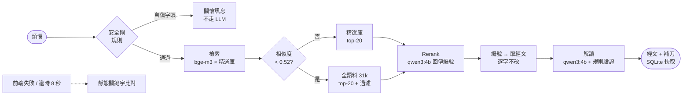

# 主的旨意 v2：本地 RAG 版

一個諷刺「斷章取義」的網站：輸入一個人生煩惱，它會挑一節聖經經文（一字不改）來「回答」，再配一句溫柔長輩口吻、把事情越弄越糟的「假牧師解讀」。

v2 把原本的前端關鍵字比對，換成完全本地執行的 RAG 後端：bge-m3 embedding 檢索、qwen3:4b（Ollama）選經文與生成解讀，跑在 M3 / 16GB 上，不呼叫任何雲端 API。這個專案的重點不只是做出來，而是**量化比較**每個設計選擇，包括「embedding 其實沒有比人工關鍵字好」這個不太討喜的結果（見 [EVALUATION.md](bible-oracle/EVALUATION.md)）。

範例（實際輸出）：

> **煩惱**：老婆一開口就是抱怨，我回家都不想講話
> **經文**：箴言 27:15「大雨之日連連滴漏、和爭吵的婦人一樣．」
> **解讀**：經文說爭吵的婦人像大雨滴漏，你回家不說話，是因為你還沒學會在雨中靜默等候。

## 展示

<video src="bible-oracle/demo/demo.mp4" poster="bible-oracle/demo/poster.jpg" controls muted width="100%"></video>

[▶ 觀看完整影片 demo.mp4](bible-oracle/demo/demo.mp4)（35 秒、1080p、含配樂）。畫面為全螢幕 WebGL2 曼陀羅聖殿：點擊中央十字架開啟詢問框，輸入煩惱後經文逐字浮現。

## 架構總覽



後端任何一步失敗都會降級（見下節），前端連後端都失敗時改用靜態關鍵字比對。

## 使用的技術

| 層 | 技術 | 用途 |
|---|---|---|
| 檢索 | bge-m3（本機 embedding）、numpy 矩陣餘弦 | 31,031 節和合本預先建索引；問題向量與經文向量比相似度 |
| 選經文 | qwen3:4b（Ollama，JSON schema 約束） | 在 20 個候選中只回傳編號，確保經文一字不改 |
| 解讀 | qwen3:4b + 規則驗證 | 一句假牧師補刀；長度、句數、禁用詞、emoji 檢查 |
| 後端 | Python 3.9、FastAPI、SQLite 快取、滑動視窗限流 | `POST /api/oracle`，啟動時暖機模型 |
| 安全 | 規則式危機偵測（Python 與 JS 兩份，有一致性測試） | 自傷字眼直接回關懷訊息，在任何檢索前攔截 |
| 前端 | vanilla ES modules（零依賴）、WebGL2 曼陀羅、Canvas 2D 後備、Web Audio 合成配樂 | 聖殿 UI；`prefers-reduced-motion` 支援 |
| 評估 | 自建 151+16+12 題資料集、hit@k、LLM-as-judge | 量化比較 B0 / B1 / B1h / B2 / B3 與 rerank 消融 |
| 測試 | pytest 263 項、node 156 項 | 後端、比對邏輯、WebGL 數學與場景建構 |

## 降級時會變成什麼

回應的 `stage` 標示實際走到哪裡。越往下越不「聰明」，但網站永遠答得出來；經文不論在哪一級都一字不改（`text` 永遠取自語料庫，或靜態的 `topics.json`）。

| 狀況 | `stage` | 經文怎麼來 | 解讀怎麼來 | 使用者感受 |
|---|---|---|---|---|
| 全部正常 | `rerank+llm` | LLM 在 20 個候選中挑最貼題的 | LLM 針對該經文與煩惱即時生成 | 最貼題、最好笑；約 3 秒 |
| 解讀失敗（驗證不過 / 生成逾時） | `rerank+template` | 同上 | 固定包裝詞（如「主已經回答了，是你還沒讀懂。」） | 經文仍貼題，補刀變成罐頭句 |
| Rerank 失敗（Ollama 掛掉、非法編號） | `top1+llm` / `top1+template` | 檢索相似度第 1 名（純 embedding，實測 hit@1 僅 4%，常離題） | LLM 或固定包裝詞 | 經文常不太相關；Ollama 掛掉時兩段都失敗，變 `top1+template` |
| 後端 503 / 前端逾時 8 秒 / 被限流 | （前端）靜態 | `match.js` 以關鍵字比對 30+6 個主題，比不到就從 `fallback.json` 隨機抽 | `topics.json` 預寫的補刀（隨機兜底則用通用句） | 可用但最弱：不看語意，只看關鍵字；離題題 18.8% 落到隨機兜底 |
| 安全閘命中 | `safety` | 不給經文 | 關懷訊息與專線（1925／1995／119） | 無動畫、無鐘聲、配樂降為近乎無聲 |

以評估數字對照：完整管線 B2 hit@1 為 58.3%；降到純 embedding 第 1 名（B1h）為 4.0%；退到靜態關鍵字（B0）為 60.9%（但那是針對同一批主題手工調校的）。

## 瓶頸與限制

- **延遲**：每次請求跑兩次 4B 模型，端到端 p50 約 3.3 秒，冷啟動可達 18 秒（所以有暖機與 8 秒前端逾時）；多個請求競爭時 p50 曾升到 13.7 秒，只適合單機展示。
- **檢索**：純 embedding 在口語煩惱上幾乎沒用（hit@1 4%），效果來自人工精選庫 + LLM 小範圍挑選；全語料展開的答案多是字面相近。
- **4B 模型**：解讀常只是重述經文，好笑度 2.45／5，低於預寫的人工補刀 3.30。
- **規則式過濾與安全閘**：會誤殺也會漏網；委婉的自傷說法可能漏掉，不是完整的心理安全方案。
- **評估偏小**：離題題 16 題、評審 n=40、資料集由模型草擬。

## 評估結果（n=151，hit@k = 選中的經文屬於該題標準主題的精選池）

| 方案 | hit@1 | hit@5 | hit@20 | 說明 |
|---|---|---|---|---|
| B0 人工調校關鍵字（v1） | 60.9% | - | - | 基線；針對同樣 30 個主題手調，對它有利 |
| B1 bge-m3 純全語料檢索 | 4.0% | 7.3% | 22.5% | 口語與經文用詞差太遠 |
| B1h 混合檢索 | 4.0% | 7.3% | 83.4% | 候選池變好，排序沒變 |
| B2 精選庫 20 + rerank + 洗牌 | 58.3% | 77.5% | 92.7% | 經文逐字相同 151/151 |
| **B3 上線**（B2 + 信心門檻 0.52 + 內容過濾） | 49.7% | 68.2% | 82.8% | 11% 題目展開全語料，命中指標因此下降，換來離題題更貼題 |

結論：有效的是「人工精選 + LLM 在小候選集上挑選」，embedding 只負責縮小範圍；最後仍略輸手調關鍵字。每個設計的消融、LLM-as-judge、信心門檻分佈、延遲與完整限制見 [EVALUATION.md](bible-oracle/EVALUATION.md)。

## 本地重現

以下指令都在 `bible-oracle/` 目錄下執行（`cd bible-oracle`）。

**語料來源**：和合本聖經的 HTML 原檔放在 repo 根目錄的 `bible-cut/`，`tools/extract.py` 從 `bible-cut/CUT/` 抽出 31,031 節產生 `data/corpus.json`，`tools/verify.py` 也用它檢查精選經文逐字相同。沒有這個資料夾就無法重建語料庫與向量索引。

需求：Python 3.9+、Node（前端測試）、[Ollama](https://ollama.com)。

```bash
python3 -m venv .venv && .venv/bin/pip install -r server/requirements.txt
.venv/bin/python tools/extract.py --corpus      # 產生 data/corpus.json（31,031 節）
.venv/bin/python tools/build_index.py           # 用 bge-m3 建立 data/index.npy
ollama pull qwen3:4b
.venv/bin/uvicorn server.main:app --port 8000   # 開 http://localhost:8000

# 評估
.venv/bin/python eval/run_eval.py b0 b1 b1h b2  # 寫入 eval/results.json（b0x：靜態模式含日常主題）
.venv/bin/python eval/rerank_experiment.py      # rerank 消融，寫入 eval/rerank_results.json
.venv/bin/python eval/judge.py sample           # 取樣並匿名化 40 題 x 3 方案
.venv/bin/python eval/judge.py summarize        # 彙整評審分數（scores.json 為評審輸出）

# 測試
.venv/bin/pytest -q && npm test
```

專案結構：

```
server/    FastAPI、pipeline、retrieve、rerank、quip、safety、cache、llm（含各自的測試）
tools/     extract.py（語料）、build_index.py（向量索引）
eval/      dataset.jsonl、run_eval.py、rerank_experiment.py、judge.py、各項結果 JSON
data/      corpus.json、index.npy、topics.json（精選庫）、extra_topics.json（僅靜態模式）、fallback.json
assets/    前端；index.html
tests/     前端比對邏輯測試（node）
```
